# kwhy

[](https://github.com/semirm-dev/kwhy/actions/workflows/ci.yml)
[](go.mod)
[](https://pkg.go.dev/github.com/semirm-dev/kwhy)
[](LICENSE)

Answers the "why" questions about Kubernetes config, using the real Helm and scheduler code instead of guesses.

| Command | Question | Works on | Status |
|---|---|---|---|
| `kwhy value` | Where does this rendered value come from? | Git repo, offline | v0.1 |
| `kwhy change` | What will merging this change actually do to running workloads? | Git repo (+ optional cluster, read-only) | v0.3 |
| `kwhy pod` | Why is this pod not running? | Live cluster, read-only | v0.6 |

> **Status:** early development. `kwhy value` works today and is checked nightly against 10 public charts.
> `kwhy change` works for Helm charts and every rule is checked against a real cluster in CI. `kwhy pod` works on
> live clusters: Pending pods are checked against the real scheduler, and crashes, pull errors, OOM kills, config,
> mount and probe failures against what kubelet reports, on kind in CI (Kubernetes 1.35–1.37).

## `kwhy value`: where does this value come from?

A rendered field can come from chart defaults, several `-f` files, `--set` flags or template logic.
`kwhy value` points at the exact line that wins, and at everything it overrides.



When a field isn't a plain copy of one value, the answer says so instead of guessing:

```console
$ kwhy value chart <chart> deploy/api '.spec.template.spec.containers[name=api].env[name=LEADER_ELECTION].value' ...

true  derived  ← replicaCount (values-prod.yaml:1)
      template  mini/templates/deployment.yaml
```

Every answer has one of these kinds, in the human output and in `-o json` (`"schema": "kwhy.value/v1"`):

| Kind | Meaning | Example |
|---|---|---|
| `direct` | the field equals one values leaf | `replicas: 3` ← `replicaCount` |
| `composed` | one or more leaves plus template text | `image: repo:tag` ← `image.repository` + `image.tag` |
| `derived` | template logic computes it from leaves | `leader-election: "true"` ← `replicaCount` |
| `encoded` | a leaf passed through `b64enc` | Secret data ← `auth.user` |
| `hashed` | checksum of other content | `checksum/config` annotation |
| `chart` | no values leaf affects it | `apiVersion`, fixed ports |
| `structural` | a leaf decides whether the field exists | `ingress.enabled` |
| `random` | differs between two identical renders | `randAlphaNum` passwords |

Other forms:

```console
$ kwhy value chart <chart> deploy/api --all ...                 # every field of the resource with its source
$ kwhy value chart <chart> deploy/api <path> ... -o markdown    # for PR comments; -o json for CI and agents
```

### How it works

kwhy doesn't read templates. It renders the chart with Helm itself, tags or changes settings on purpose, and
watches which lines of output change. The [illustrated walkthrough](https://claude.ai/artifact/DUEg6FMnDfw65yfdUWJj4v)
covers every step with diagrams, explained in plain words and mapped to the code behind it.

### What works today

The engine underneath is in place: in-process Helm rendering (`render/`) and the override chain of every
values leaf (`value/`). For the fixture chart in `testdata/` with
`-f values-prod.yaml -f values-anchors.yaml --set image.tag=9.9`, it already knows:

```
replicaCount               3      values-prod.yaml:1=3        mini/values.yaml:1=1
resources.requests.memory  4Gi    values-anchors.yaml:2=4Gi   values-prod.yaml:4=2Gi   mini/values.yaml:7=512Mi
image.tag                  9.9    --set:0=9.9                 mini/values.yaml:4=
sub.greeting               hi     values-prod.yaml:8=hi       mini/charts/sub/values.yaml:1=hello
global.env                 prod   values-prod.yaml:10=prod    mini/values.yaml:17=dev
```

It follows Helm's own merge rules: later files win, maps merge, lists replace whole, `null` deletes,
subchart defaults mount under their name or alias, and YAML anchors point at the line where the value is written.

On top of that, marker tracing matches rendered fields to these leaves, every answer gets one of the eight
kinds, and `kwhy value` prints them (`--all`, `-o human|markdown|json`) for local charts.

Accuracy is checked against 10 pinned public charts (`go test -tags accuracy ./value/`, run nightly in CI).
All 10 pass: kwhy never named a wrong setting (precision 1.00), and it found at least 98% of the settings
that really change a field (recall 0.98–1.00, up to 50 settings checked per chart).

One field, end to end, on an 8-core M1 Pro:

| Chart | Values leaves | Time |
|---|---|---|
| podinfo, external-dns, ingress-nginx, grafana | 68–243 | 0.02–0.35s |
| postgresql, redis, cert-manager, keycloak | 189–569 | 0.9–1.7s |
| argo-cd | 758 | 3.8s |
| kube-prometheus-stack | 1247 | 21s |

Nearly all of it is tracing the whole chart, which every run repeats, so a second question about the
same chart costs the same again.
Progress is tracked in the [v0.1 plan](docs/plans/2026-11-18-v0.1-value.md).

## `kwhy change`: what will this PR do? (v0.3–v0.8)

Diff tools show the full rendered diff. `kwhy change` says what the diff *does*, as one short PR comment
(target output):



Real output, for a chart deployed to a kind cluster:

```console
$ kwhy change main~1..main --chart chart -n kwhy-demo --context kind-kwhy --fail-on fail
Merging this change will:
⏱ ordered    StatefulSet kwhy-demo/postgres                      3 pods  one at a time, ~30s
! no effect  ConfigMap kwhy-demo/cfg → Deployment kwhy-demo/api          env var: running pods keep the OLD value until they restart
✗ will fail  Job kwhy-demo/migrate                                       spec.template is immutable
✗ will fail  StatefulSet kwhy-demo/cache                                 spec.serviceName is immutable
3 pods restarted · est. 30s · 2 apply errors
kwhy: --fail-on: will fail Job kwhy-demo/migrate
```

It renders the chart at both refs (temporary `git worktree` checkouts, removed afterwards), or reads a directory
of plain YAML with `--manifests DIR`, or every app at once (v0.8): the targets of a `.kwhy.yaml`, or the Argo CD
`Application`s and Flux `HelmRelease`s under `--apps DIR` that point into this repo (with their value files,
parameters, inline values, release name and namespace; anything it can't render from the repo is skipped with a
warning naming it). An app added or removed in the PR shows as `create` or `delete`. Then it and classifies every changed object: `restart`, `ordered`, `scale`,
`resize` (PVC growth), `recreate` (Argo `Replace`/`Force`), `runs as hook`, `no effect` / `delayed` /
`picked up` for ConfigMap and Secret consumers, `will fail` for immutable fields, `no endpoints` for a Service
whose selector stops matching its pods, `data` for deletes that lose stored data, and `create` / `delete`.
Restarts that pull a mutable tag (`:latest` or untagged) say so.

Offline, pod counts come from the manifests' `replicas`. `--context` reads the cluster (get and list only) for
live replica counts, HPA ranges, DaemonSet node counts, whether a claim's StorageClass can expand, and a rollout
estimate (batches from `maxSurge`/`maxUnavailable`, each ~10s start plus readiness delay and `minReadySeconds`),
and whether a Deployment's surge pods fit the namespace's ResourceQuota.

Every rule kubectl can observe is checked in CI on kind (Kubernetes N-2..N): `testdata/change/` holds one
base/head fixture per rule, and the suite applies both and compares the cluster with the prediction. Upgrades of
ingress-nginx, argo-cd, cert-manager and grafana must not predict a false `will fail`.

### GitHub Action

```yaml
on: pull_request
permissions: {contents: read, pull-requests: write}
jobs:
  kwhy:
    runs-on: ubuntu-latest
    steps:
      - uses: actions/checkout@v5
        with: {fetch-depth: 0}   # kwhy needs both refs
      - uses: semirm-dev/kwhy@v0.4.1
        with:
          chart: charts/api
          values: values-prod.yaml
          fail-on: fail,data-loss
```

It posts one comment per PR and updates it on every push, comparing the PR's base with the merge commit.
Inputs: `chart`, `manifests`, `config` or `apps` (none: `.kwhy.yaml`), `values` and `set` (one per line), `release`, `namespace`, `kube-version`,
`fail-on`, `base`, `head`, `version` (kwhy release, default latest), `comment`. Linux, macOS and Windows runners.

## `kwhy pod`: why isn't it running? (v0.5)

Two cases, one command. It says what's wrong; fixing it stays with you.

**On a node but not running or not ready** (v0.5): kwhy reads the pod's status and events and names each failing
container's problem as kubelet reported it: `pull`, `crash` (exit code, restarts), `oom` (the limit it hit),
`config` (missing Secret, ConfigMap or key), `mount`, `probe`, `evicted`, `sandbox`, `node` (the node isn't Ready
or is under pressure), or `other` with kubelet's reason. Init containers come first; a past OOM kill of a container
that's fine now shows as `oom (earlier)`. Real output on kind:

```console
$ kwhy pod deploy/api -n shop --logs 5
shop/api-7786cbf6bb-txlt8 on kwhy-pod-worker · Running · not ready · 2 containers, 1 failing

CONTAINER  PROBLEM  DETAIL
api        oom      killed at limit 32Mi, 4 restarts, last 1m ago
proxy      ✓

Events:
  api: Back-off restarting failed container api in pod api-7786cbf6bb-txlt8_shop(9b22ae5a-f48d-4749-a5f1-8608dac549dc)

Logs (api, last run):
  starting cache warm-up

$ kwhy pod deploy/worker -n shop --logs 5
shop/worker-6b697b77cd-dh92v on kwhy-pod-worker2 · Running · not ready · 1 container, 1 failing

CONTAINER  PROBLEM  DETAIL
worker     crash    exit 1, 3 restarts, last 20s ago

Logs (worker, last run):
  connecting to db:5432
  fatal: password authentication failed
```

kwhy never guesses why an app exits: `exit 1` is all kubelet knows, and the logs (opt-in, `--logs N`) are the app's
own words. With `--chart`, problems link to values like checks do (from the test suite, the test chart with
`--set resources.limits.memory=4Gi`): `oom (api)  .spec.containers[0].resources.limits.memory = 4Gi  ← resources.limits.memory (--set resources.limits.memory=4Gi)`.
For a workload (`deploy/`, `sts/`, `ds/`, `job/`) it explains the worst pod (unscheduled first, then the
not-ready one with the most restarts, then one stuck terminating), or says `all N pods ready`. It also reads the
workload's controller (v0.6): pods a ReplicaSet, StatefulSet, DaemonSet or Job can't create (`create`: quota,
PodSecurity, webhooks), a Deployment rollout past its deadline (`rollout`), a failed Job (`job`). A pod deleted but
still there gets `terminating` with its finalizers. Real output on kind, for a namespace with a zero-pod quota:

```console
$ kwhy pod deploy/target -n shop
shop/deploy/target · no pod to check · 1 problem from its controller

CONTAINER     PROBLEM  DETAIL
(controller)  create   replicaset target-f5bdbb58: pods "target-f5bdbb58-v7thh" is forbidden: exceeded quota: no-pods, requested: pods=1, used: pods=0, limited: pods=0
```

**Not scheduled (Pending)** (v0.4): runs the real kube-scheduler filters on every node and shows every failing
check, not just the first one the scheduler reports. It adds what Cluster Autoscaler or Karpenter last said about
the pod (`autoscaler`), and, for a pod that may preempt, the nodes it would fit on if lower-priority pods there were
preempted (v0.6).

Real output, for a Deployment asking for a gpu node and 40 CPUs on a 3-node kind cluster:

```console
$ kwhy pod deploy/train -n ml --context kind-kwhy-pod
ml/train-b977cbd9c-8ct8w Pending 3s · 0 of 3 nodes fit · every check, every node

NODE                    TaintToleration  NodeAffinity  NodeResourcesFit
kwhy-pod-control-plane  ✗                ✗             ✗ cpu 0.95/32 +40
kwhy-pod-worker         ✓                ✓             ✗ cpu 0.1/32 +40
kwhy-pod-worker2        ✓                ✗             ✗ cpu 0.1/32 +40

Reasons:
  TaintToleration: node(s) had untolerated taint(s)
  NodeAffinity: node(s) didn't match Pod's node affinity/selector
  NodeResourcesFit: Insufficient cpu
```

The scheduler's own event for this pod names one reason per node (`1 Insufficient cpu, 1 node(s) didn't match Pod's
node affinity/selector, 1 node(s) had untolerated taint(s)`), so fixing the selector would only reveal the CPU problem
next. Columns are the checks that fail somewhere; `cpu 0.1/32 +40` is requested/allocatable on the node plus the
pod's request. Nodes with identical results share a row (`cpu-* (9)`).

With `--chart` (v0.4.1) and the values the release was deployed with, it also names the values line behind each
field a failing check reads. Real output, for the test chart installed with Helm on kind:

```console
$ kwhy pod deploy/rel-api -n demo --chart testdata/charts/mini -f testdata/values-prod.yaml --set resources.requests.cpu=40 --release rel
...
Source:
  NodeResourcesFit  .spec.containers[0].resources.requests.cpu = 40  ← resources.requests.cpu (--set resources.requests.cpu=40)
```

It reads the cluster once with get and list only (nodes, pods, namespaces, volumes, claims, storage and CSI objects),
then runs the default scheduler profile in-process: once as the scheduler would, and once per filter plugin so
none stops the others. For a workload (`deploy/`, `sts/`, `job/`) it picks the oldest pod waiting for a node, or
checks a new pod from the template when none is waiting.

How it differs from other tools for Pending pods:

| | kwhy | Tools that re-implement the checks (e.g. kubectl-why-pending) | LLM explainers (e.g. k8sgpt) | `kubectl describe` event |
|---|---|---|---|---|
| Where the answer comes from | the scheduler's own code, compiled in | hand-written copy of the rules | a model's reading of events | the scheduler |
| Matches the real scheduler | yes, checked against the scheduler's own message on kind (1.35–1.37) | until the rules drift | not guaranteed | yes |
| Failing checks per node | all of them | depends on the tool | — | first one only, summarised |
| New scheduler rules | come with a Kubernetes version bump | rewritten by hand | — | yes |
| Line in your values that set the field | yes, with `--chart` (through `kwhy value`) | no | no | no |

The other tools are useful in their own ways. kubectl-why-pending, for example, suggests fixes, which kwhy
deliberately doesn't do.

## Install

Download the archive for your platform (macOS, Linux or Windows; amd64 or arm64) from
[GitHub Releases](https://github.com/semirm-dev/kwhy/releases), unpack it and put `kwhy` on your `PATH`.

As a kubectl plugin (`kubectl kwhy ...`): each release from v0.4 attaches a Krew manifest, `kwhy.yaml`. Until kwhy is
in the Krew index, install it with `kubectl krew install --manifest=kwhy.yaml`.

Single static binary, offline by default, no telemetry. Homebrew comes later.

## Flags (`kwhy value chart`)

| Flag | Meaning |
|---|---|
| `<chart>` (first argument) | chart directory, `.tgz`, `oci://` reference or `repo/chart` |
| `--version V` | chart version, for repo and OCI charts |
| `-f, --values FILE` | values file or URL, repeatable, later wins |
| `--set K=V`, `--set-string`, `--set-json`, `--set-file`, `--set-literal` | as for `helm`, applied in Helm's order (json, set, string, file, literal) |
| `--release NAME`, `-n, --namespace NS` | release name (default `rel`) and namespace (default `default`) |
| `--kube-version V` | Kubernetes version charts see in `.Capabilities` (default `v1.37.0`) |
| `-o, --output` | `human` (default), `markdown` or `json` |
| `--all` | every field of the resource instead of one path |
| `--chunk-size N` | values leaves marked per tracing render (default 10; tuning only) |
| `--no-cache` | trace again instead of reusing the cached trace and answers (in the user cache dir, keyed by chart, values, options and the kwhy binary) |
| `--repository-config`, `--repository-cache`, `--registry-config`, `--content-cache` | Helm's paths, same defaults as `helm` |

Exit codes: `0` ok, `1` runtime error, `2` usage error.

## Flags (`kwhy change`)

| Flag | Meaning |
|---|---|
| `<base>..<head>` (argument) | the two git refs to compare, e.g. `main..feature` |
| `--chart DIR` | chart directory in the repo (this or `--manifests`) |
| `--manifests DIR` | directory of plain YAML in the repo, read at each ref; a Kustomize directory is refused |
| `--config FILE` | several targets: `targets: [{chart or manifests, values, set, setString, setJSON, release, namespace}]`; `.kwhy.yaml` is used when no source flag is given |
| `--apps DIR` | Argo CD `Application`s and Flux `HelmRelease`s under DIR: render every app they point at in this repo |
| `-f, --values FILE` | values file or URL, repeatable, later wins; files in the repo are read at each ref |
| `--set K=V`, `--set-string`, `--set-json`, `--set-file`, `--set-literal` | as for `helm` (with `--chart`) |
| `--release NAME`, `-n, --namespace NS` | release name (default `rel`) and namespace (default `default`) |
| `--kube-version V` | Kubernetes version charts see in `.Capabilities` (default `v1.37.0`) |
| `-o, --output` | `human` (default), `markdown` (PR comment, kept under GitHub's 65,000 characters) or `json` (`"schema": "kwhy.change/v1"`) |
| `--fail-on V,...` | exit `3` if any of these verdicts occur: `fail`, `data-loss`, or any verdict with `-` for spaces (`restart`, `no-effect`, ...) |
| `--context NAME` | kube context to read live state from, read-only (default: offline) |

Run it from inside the git repo. Exit codes: `0` ok, `1` runtime error, `2` usage error, `3` a `--fail-on` verdict occurred.

## Flags (`kwhy pod`)

| Flag | Meaning |
|---|---|
| `<name>` (argument) | a pod (`x`, `pod/x`) or a workload (`deploy/x`, `sts/x`, `ds/x`, `job/x`) |
| `-n, --namespace NS` | namespace (default: the kube context's) |
| `--context NAME` | kube context to read from, read-only |
| `-o, --output` | `human` (default), `markdown` or `json` (`"schema": "kwhy.pod/v1"`, every node with all failing checks and the scheduler's first) |
| `--chart CHART` | chart that deploys the pod (directory, `.tgz`, `oci://` or `repo/chart`): adds the values line behind each field a failing check reads |
| `-f`, `--set`, `--set-string`, `--set-json`, `--set-file`, `--set-literal`, `--version V` | as the release was deployed (with `--chart`) |
| `--no-cache` | with `--chart`: trace the chart again instead of reusing the cached trace |
| `--release NAME` | Helm release name (default: the pod's `app.kubernetes.io/instance` label) |
| `--logs N` | last N log lines of a crashed or OOM-killed container's last run (default 0: none; logs may contain secrets, so they're never read unless asked) |

A healthy pod gets one line (`ns/x is on node-1, Running and ready.`); JSON has `"scheduled"` and `"problems"`
(`kind`, `container`, `reason`, `detail`, `events`, `logs`).

Exit codes: `0` ok (a diagnosis is an answer, not an error), `1` runtime error, `2` usage error.

## Known limits

- `lookup` returns empty, as with `helm template` (offline).
- Kustomize is not supported yet.
- `change --apps` reads Argo CD and Flux definitions from the working tree, not from each ref, and skips apps from
  other repos, Helm repositories, Flux `valuesFrom` and Kustomize. Without `--context`, DaemonSet pod counts are
  unknown ("one pod per node").
- The first question about a chart traces it whole (~20s on kube-prometheus-stack); repeats with the same chart
  and values come from the cache (argo-cd: 9s → 0.2s).
- `pod` runs the default scheduler profile compiled into kwhy (v1.37) and warns when the cluster is more than one
  minor version away or the pod names another scheduler. Custom profiles and scheduler plugins aren't seen.
- `pod` doesn't support pods with resource claims (DRA). Its preemption hint ignores PodDisruptionBudgets and
  nominated pods. What's missing across all three commands is in the [backlog](docs/plans/2026-11-20-backlog.md).
- `pod --chart` links only fields a values leaf sets; a field hardcoded in a chart template gets no `Source:` line.

## Development

```sh
gofmt -l .            # must print nothing
go vet ./...
go test -race ./...
```

```
cmd/kwhy/    CLI wiring (cobra): flags in, features out
render/      Helm rendering in-process, shared by value and change
value/       values leaves, override chains, tracing (v0.1)
change/      base/head render, impact rules, live refinement, report (v0.3)
pod/         cluster snapshot, every filter per node, report (v0.4); the only package importing k8s.io/kubernetes
docs/        specs, plans, spikes
```

Design: [overview](docs/specs/00-overview.md) · [value](docs/specs/01-value.md) ·
[change](docs/specs/02-change.md) · [pod](docs/specs/03-pod.md)

## License

[Apache-2.0](LICENSE)
