# kwhy

[](https://github.com/semirm-dev/kwhy/actions/workflows/ci.yml)
[](go.mod)
[](https://pkg.go.dev/github.com/semirm-dev/kwhy)
[](LICENSE)

Answers the "why" questions about Kubernetes config, using the real Helm and scheduler code instead of guesses.

| Command | Question | Works on | Status |
|---|---|---|---|
| `kwhy value` | Where does this rendered value come from? | Git repo, offline | v0.1 |
| `kwhy change` | What will merging this change actually do to running workloads? | Git repo (+ optional cluster) | planned, v0.3 |
| `kwhy pod` | Why is this pod not running? | Live cluster, read-only | planned, v0.4 |

> **Status:** early development. `kwhy value` works today and is checked nightly against 10 public charts.
> The `change` and `pod` examples below show planned output from the [specs](docs/specs).

## `kwhy value`: where does this value come from?

A rendered field can come from chart defaults, several `-f` files, `--set` flags or template logic.
`kwhy value` points at the exact line that wins, and at everything it overrides.


When a field isn't a plain copy of one value, the answer says so instead of guessing:

```console
$ kwhy value chart <chart> deploy/api '.spec.template.spec.containers[name=api].env[name=LEADER_ELECTION].value' ...

true  derived  ← replicaCount (values-prod.yaml:1)
      template  mini/templates/deployment.yaml
```

Every answer has one of these kinds, in the human output and in `-o json` (`"schema": "kwhy.value/v1"`):

| Kind | Meaning | Example |
|---|---|---|
| `direct` | the field equals one values leaf | `replicas: 3` ← `replicaCount` |
| `composed` | one or more leaves plus template text | `image: repo:tag` ← `image.repository` + `image.tag` |
| `derived` | template logic computes it from leaves | `leader-election: "true"` ← `replicaCount` |
| `encoded` | a leaf passed through `b64enc` | Secret data ← `auth.user` |
| `hashed` | checksum of other content | `checksum/config` annotation |
| `chart` | no values leaf affects it | `apiVersion`, fixed ports |
| `structural` | a leaf decides whether the field exists | `ingress.enabled` |
| `random` | differs between two identical renders | `randAlphaNum` passwords |

Other forms:

```console
$ kwhy value chart <chart> deploy/api --all ...                 # every field of the resource with its source
$ kwhy value chart <chart> deploy/api <path> ... -o markdown    # for PR comments; -o json for CI and agents
```

### How it works

kwhy doesn't read templates. It renders the chart with Helm itself, tags or changes settings on purpose, and
watches which lines of output change. The [illustrated walkthrough](https://claude.ai/artifact/DUEg6FMnDfw65yfdUWJj4v)
covers every step with diagrams, explained in plain words and mapped to the code behind it.

### What works today

The engine underneath is in place: in-process Helm rendering (`render/`) and the override chain of every
values leaf (`value/`). For the fixture chart in `testdata/` with
`-f values-prod.yaml -f values-anchors.yaml --set image.tag=9.9`, it already knows:

```
replicaCount               3      values-prod.yaml:1=3        mini/values.yaml:1=1
resources.requests.memory  4Gi    values-anchors.yaml:2=4Gi   values-prod.yaml:4=2Gi   mini/values.yaml:7=512Mi
image.tag                  9.9    --set:0=9.9                 mini/values.yaml:4=
sub.greeting               hi     values-prod.yaml:8=hi       mini/charts/sub/values.yaml:1=hello
global.env                 prod   values-prod.yaml:10=prod    mini/values.yaml:17=dev
```

It follows Helm's own merge rules: later files win, maps merge, lists replace whole, `null` deletes,
subchart defaults mount under their name or alias, and YAML anchors point at the line where the value is written.

On top of that, marker tracing matches rendered fields to these leaves, every answer gets one of the eight
kinds, and `kwhy value` prints them (`--all`, `-o human|markdown|json`) for local charts.

Accuracy is checked against 10 pinned public charts (`go test -tags accuracy ./value/`, run nightly in CI).
All 10 pass: kwhy never named a wrong setting (precision 1.00), and it found at least 98% of the settings
that really change a field (recall 0.98–1.00, up to 50 settings checked per chart).

One field, end to end, on an 8-core M1 Pro:

| Chart | Values leaves | Time |
|---|---|---|
| podinfo, external-dns, ingress-nginx, grafana | 68–243 | 0.02–0.35s |
| postgresql, redis, cert-manager, keycloak | 189–569 | 0.9–1.7s |
| argo-cd | 758 | 3.8s |
| kube-prometheus-stack | 1247 | 21s |

Nearly all of it is tracing the whole chart, which every run repeats, so a second question about the
same chart costs the same again.
Progress is tracked in the [v0.1 plan](docs/plans/2026-11-18-v0.1-value.md).

## `kwhy change`: what will this PR do? (planned, v0.3)

Diff tools show the full rendered diff. `kwhy change` says what the diff *does*, as one short PR comment:


## `kwhy pod`: why is it Pending? (planned, v0.4)

Runs the real kube-scheduler filters on every node and shows every failing check, not just the first one the
scheduler reports. It says what's wrong; fixing it stays with you:



## Install

Download the archive for your platform (macOS, Linux or Windows; amd64 or arm64) from
[GitHub Releases](https://github.com/semirm-dev/kwhy/releases), unpack it and put `kwhy` on your `PATH`. Or build it:

```sh
go install github.com/semirm-dev/kwhy/cmd/kwhy@latest
```

Single static binary, offline by default, no telemetry. Homebrew and Krew as `kubectl kwhy` (v0.4) come later.

## Flags (`kwhy value chart`)

| Flag | Meaning |
|---|---|
| `<chart>` (first argument) | chart directory, `.tgz`, `oci://` reference or `repo/chart` |
| `--version V` | chart version, for repo and OCI charts |
| `-f, --values FILE` | values file or URL, repeatable, later wins |
| `--set K=V` | set a value, repeatable, wins over files |
| `--release NAME`, `-n, --namespace NS` | release name (default `rel`) and namespace (default `default`) |
| `--kube-version V` | Kubernetes version charts see in `.Capabilities` (default `v1.37.0`) |
| `-o, --output` | `human` (default), `markdown` or `json` |
| `--all` | every field of the resource instead of one path |
| `--chunk-size N` | values leaves marked per tracing render (default 10; tuning only) |
| `--repository-config`, `--repository-cache`, `--registry-config`, `--content-cache` | Helm's paths, same defaults as `helm` |

Exit codes: `0` ok, `1` runtime error, `2` usage error.

## Known limits

- `lookup` returns empty, as with `helm template` (offline).
- Kustomize is not supported yet.
- Every run traces the whole chart again; nothing is cached between runs (~20s on kube-prometheus-stack).

## Development

```sh
gofmt -l .            # must print nothing
go vet ./...
go test -race ./...
```

```
cmd/kwhy/    CLI wiring (cobra): flags in, features out
render/      Helm rendering in-process, shared by value and change
value/       values leaves, override chains, tracing (v0.1)
change/      v0.3
pod/         v0.4, the only package importing k8s.io/kubernetes
docs/        specs, v0.1 plan, spikes
```

Design: [overview](docs/specs/00-overview.md) · [value](docs/specs/01-value.md) ·
[change](docs/specs/02-change.md) · [pod](docs/specs/03-pod.md)

## License

[Apache-2.0](LICENSE)
